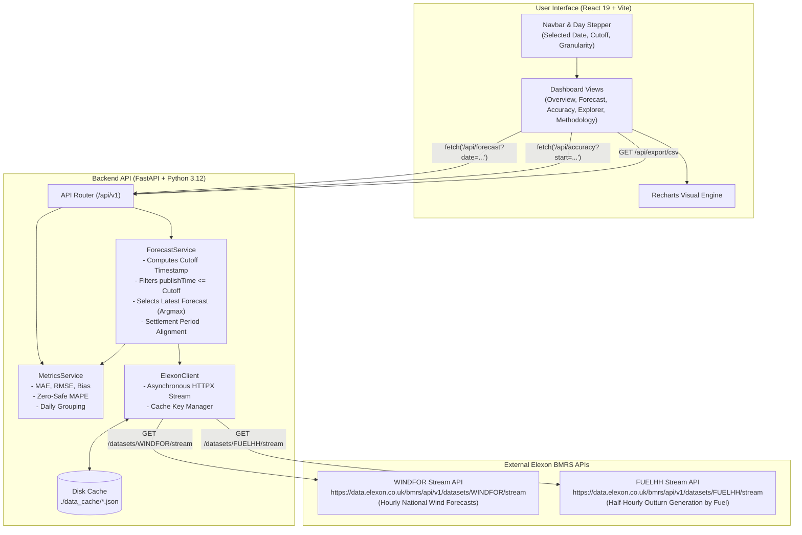

# REint AI — Renewable Energy Intelligence Platform
### UK Day-Ahead Wind Generation Forecast Analytics & Decision Support

[](https://fastapi.tiangolo.com)
[](https://react.dev)
[](https://vitejs.dev)
[](https://www.docker.com)
[](#p-license-and-acknowledgements)

---

## Table of Contents

- [A. Project Overview](#a-project-overview)
- [B. Problem Statement and Objectives](#b-problem-statement-and-objectives)
- [C. Key Features](#c-key-features)
- [D. Technology Stack](#d-technology-stack)
- [E. System Architecture](#e-system-architecture)
- [F. Data Sources and APIs](#f-data-sources-and-apis)
- [G. Forecast Selection and Data Processing](#g-forecast-selection-and-data-processing)
- [H. Accuracy Metrics](#h-accuracy-metrics)
- [I. Installation and Local Setup](#i-installation-and-local-setup)
- [J. Environment Variables](#j-environment-variables)
- [K. API Routes](#k-api-routes)
- [L. Testing and Validation](#l-testing-and-validation)
- [M. Limitations and Assumptions](#m-limitations-and-assumptions)
- [N. Future Improvements](#n-future-improvements)
- [O. AI Tool Usage](#o-ai-tool-usage)
- [P. License and Acknowledgements](#p-license-and-acknowledgements)

---

## A. Project Overview

**REint AI** is an analytical decision-support platform designed for UK electricity utilities, power procurement desks, and energy traders operating in the Great Britain (GB) wholesale power market.

In modern power grids, wind energy provides a major share of zero-carbon electricity. However, because wind output varies with weather, utilities must purchase electricity from conventional generation (e.g. thermal or hydro) in the **Day-Ahead Market (DAM)** to guarantee that consumer demand is balanced. To avoid costly real-time imbalances, trading desks must rely on day-ahead wind forecasts.

REint AI solves a fundamental operational challenge: **evaluating the accuracy of renewable generation forecasts at the exact moment purchase decisions are committed, without look-ahead bias.**

The platform reconstructs the exact National Grid ESO (NGESO) wind generation forecasts that were available at day-ahead gate closure, aligns them with authoritative outturn generation from Elexon BMRS across **January 2026**, computes mathematical error metrics (MAE, RMSE, Bias, MAPE), and delivers actionable insights through a modern interface.

---

## B. Problem Statement and Objectives

### The Commercial Challenge
An electricity utility in the United Kingdom serving retail consumers must procure power one day before delivery. The procurement equation is driven by residual demand:

$$\text{Procurement Target} = \text{Consumer Electricity Demand} - \text{Renewable Generation}$$

1. **Volume Uncertainty**: Wind generation is weather-dependent and volatile.
2. **Timing of Decisions**: Wholesale power purchase commitments in the day-ahead auction (such as EPEX SPOT or Nord Pool) close in late morning on **D-1** (typically around 10:00–12:00 UTC).
3. **Imbalance Cost Risk**: 
   - **Overforecasting (Forecast > Actual)**: The utility procures too little backup power. In real time, the shortfall must be settled at volatile, often punitive system buy prices in the Balancing Mechanism.
   - **Underforecasting (Forecast < Actual)**: The utility over-procures thermal power at high day-ahead prices, leaving surplus energy that is sold back at low system sell prices.

### Platform Objectives
REint AI provides procurement teams with the tools to:
1. **Reconstruct Available Information**: Clearly view the latest eligible renewable forecast available at the specific day-ahead decision cutoff (e.g. 10:00 UTC on D-1).
2. **Quantify Forecasting Error**: Mathematically measure historical forecast error, systematic bias, and dispersion (MAE, RMSE) for every delivery day and interval.
3. **Factor Error Uncertainty into Procurement**: Enable traders to size hedging buffers and contingency reserves based on empirical forecast performance rather than guesswork.

> **Scope Note**: REint AI evaluates the national-level wind forecast and actual generation datasets provided by Elexon BMRS (`WINDFOR` and `FUELHH`). It does not calculate consumer electricity demand, exact financial trading profits, or optimal dispatch schedules, as those depend on proprietary utility customer load and pricing contracts.

---

## C. Key Features

Every feature documented below is implemented and functional in the codebase:

### 1. Day-Ahead Decision Cutoff Engine
- **Configurable D-1 Cutoff Time**: Selectable decision cutoff times (e.g. 08:00, 10:00, 11:00, 12:00, 16:00 UTC on D-1).
- **Strict Look-Ahead Bias Prevention**: All forecasts published after the cutoff are automatically excluded from the day-ahead evaluation set.
- **Publication Timestamp Audit**: Displays the exact `publishTime` for each interval's forecast alongside the target delivery time.

### 2. Dual-Resolution Granularity
- **Hourly Alignment (24 intervals)**: Aggregates half-hourly actuals to match standard 1-hour wholesale block contracts.
- **Half-Hourly Settlement Alignment (48 periods)**: Maps hourly forecasts to standard 30-minute GB Settlement Periods (SP 1–48) for Balancing Mechanism imbalance analysis.

### 3. Interactive Visualization Dashboard
- **Overview Dashboard**: High-level KPI summary cards (Average Forecast, Average Actual, Peak Forecast, MAE, Bias), coupled with an interactive Recharts generation overlay.
- **Forecast vs. Actual Curve**: Smooth area and line curves with tooltips displaying interval generation and signed error in MW.
- **Signed Error Decomposition Bar Chart**: Color-coded divergence chart highlighting surplus (overforecasting) versus deficit (underforecasting) intervals with a zero reference baseline.
- **Daily Performance Trend (January 2026)**: Tracks daily MAE and Bias across all 31 days of January 2026.

### 4. Granular Analytical Data Explorer
- **Interval-by-Interval Table**: Full visibility into interval index, start/end timestamps, settlement period, forecast MW, actual MW, signed error, absolute error, and percentage error.
- **Client-Side Filtering & Sorting**: Filter by status (`Matched`, `High Error > 1000 MW`, `Missing`), search by settlement period, or sort by any column.
- **Direct CSV Data Export**: Download filtered observations directly from the backend API as RFC 4180-compliant CSV files.

### 5. Unified Modern Design & Brand System
- **Single Canonical Logo**: An authentic vector brand mark featuring a dual-hemisphere Brain (biological intelligence) and Electronic Circuit (artificial intelligence) in emerald green (`#15803d`), unified across the header, loading state, footer, and browser favicon.
- **Clean Aesthetic**: Crisp white cards, high-contrast ink typography (Inter font), and subtle micro-interactions inspired by enterprise energy platforms.

---

## D. Technology Stack

### Frontend
| Technology | Version | Purpose |
|:---|:---|:---|
| **React** | `19.3.1` | Component-based user interface architecture |
| **TypeScript** | `7.0.2` | Static type checking and strict interface definitions |
| **Vite** | `8.3.5` | Fast build tool and development server |
| **Tailwind CSS** | `3.4.17` | Utility-first CSS layout engine |
| **Vanilla CSS** | — | Core design tokens, custom scrollbars, and card states (`src/index.css`) |
| **Recharts** | `3.10.1` | Responsive, accessible SVG time-series and bar charts |
| **Lucide React** | `1.62.0` | Semantic iconography |

### Backend
| Technology | Version | Purpose |
|:---|:---|:---|
| **Python** | `3.12 / 3.13` | Application runtime environment |
| **FastAPI** | `>=0.115.0` | Asynchronous high-performance REST API |
| **Uvicorn** | `>=0.32.0` | ASGI production web server |
| **Pydantic v2** | `>=2.10.0` | Data validation and schema serialization |
| **HTTPX** | `>=0.28.0` | Asynchronous HTTP client for external Elexon APIs |
| **Pandas & NumPy** | `>=2.2.0 / >=2.1.0` | Numerical processing and statistical calculations |
| **Pytest** | `>=8.3.0` | Automated unit and integration testing |

### Infrastructure
| Technology | Purpose |
|:---|:---|
| **Docker & Docker Compose** | Containerized multi-service orchestration |
| **Nginx (Alpine)** | Production static frontend web server and reverse proxy |
| **Disk-Backed JSON Cache** | Local persistence layer for immutable historical Elexon datasets (`data_cache/`) |

---

## E. System Architecture

The following diagram illustrates the complete data flow from Elexon BMRS through the processing pipeline to the user interface:



For full architectural details, see the dedicated [Architecture Documentation](docs/ARCHITECTURE.md).

---

## F. Data Sources and APIs

The platform consumes two official, public Elexon BMRS OpenAPI stream endpoints:

### 1. WINDFOR (Wind Generation Forecasts)
- **Documentation**: [Elexon WINDFOR Stream Documentation](https://bmrs.elexon.co.uk/api-documentation/endpoint/datasets/WINDFOR/stream)
- **Live Endpoint**: `https://data.elexon.co.uk/bmrs/api/v1/datasets/WINDFOR/stream`
- **Query Parameters Used**:
  - `publishDateTimeFrom` (ISO UTC): Set to 3 days prior to target delivery date to capture forecasts issued ahead of time.
  - `publishDateTimeTo` (ISO UTC): Upper boundary for query range.
- **Temporal Resolution**: **Hourly** (24 intervals per day, projecting up to 72 hours ahead).
- **Key Fields**:
  - `publishTime`: Timestamp when NGESO generated and published the forecast.
  - `startTime`: Target delivery hour being forecasted.
  - `generation`: Predicted wind generation in Megawatts (MW).

### 2. FUELHH (Actual Half-Hourly Generation by Fuel Type)
- **Documentation**: [Elexon FUELHH Stream Documentation](https://bmrs.elexon.co.uk/api-documentation/endpoint/datasets/FUELHH/stream)
- **Live Endpoint**: `https://data.elexon.co.uk/bmrs/api/v1/datasets/FUELHH/stream`
- **Query Parameters Used**:
  - `publishDateTimeFrom` (ISO UTC): Beginning of the target delivery window.
  - `publishDateTimeTo` (ISO UTC): End of delivery window plus a 4-hour buffer to ensure all 48 settlement periods are received.
- **Filtering**: Filtered strictly in memory to records where `fuelType == "WIND"`.
- **Temporal Resolution**: **Half-Hourly** (48 Settlement Periods per day).
- **Key Fields**:
  - `settlementDate`: Delivery date (YYYY-MM-DD).
  - `settlementPeriod`: GB settlement period integer (1 to 48).
  - `startTime`: Interval start timestamp.
  - `generation`: Actual outturn metered wind generation in Megawatts (MW).

---

## G. Forecast Selection and Data Processing

To reconstruct what a trader knew at gate closure, the backend executes the following algorithmic steps:

```
                          Forecast Selection Pipeline
                          
       Raw WINDFOR Records                      Raw FUELHH Records
               |                                        |
               v                                        v
   [ Filter: publishTime <= Cutoff ]         [ Filter: fuelType == 'WIND' ]
               |                                        |
               v                                        v
   [ Group by: target startTime ]            [ Map by: settlementPeriod ]
               |                                        |
               v                                        v
   [ Argmax: latest publishTime ]            [ Alignment: Hourly Mean ]
               \                                       /
                \                                     /
                 v                                   v
             [ Matched Interval Record: Error = Forecast - Actual ]
```

### 1. Decision Cutoff Computation
For delivery date $D$ and cutoff time $t$ (e.g. `10:00`):
$$T_{\text{cutoff}} = (D - 1 \text{ day}) \text{ at } t \text{ UTC}$$
*Example*: For delivery on `2026-01-16`, cutoff is `2026-01-15T10:00:00Z`.

### 2. Eliminating Look-Ahead Bias
Any forecast record with `publishTime > cutoff` is excluded:
$$\mathcal{F}_{\text{eligible}} = \{ f \in \text{WINDFOR} \mid f.\text{publishTime} \le T_{\text{cutoff}} \}$$

### 3. Selecting the Latest Available Forecast
For each target interval `startTime`:
$$f^*(T_{\text{target}}) = \operatorname*{argmax}_{f \in \mathcal{F}_{\text{eligible}}} (f.\text{publishTime})$$
Ties are resolved deterministically by comparing generation values.

### 4. Resolution Alignment
- **Hourly Mode**: Forecast is matched directly. Actual generation is the mean of the two half-hourly periods:
  $$A_h = \frac{A_{\text{SP } 2h+1} + A_{\text{SP } 2h+2}}{2}$$
- **Half-Hourly Mode**: The hourly forecast is assigned to both constituent 30-minute settlement periods ($SP 1$ and $SP 2$).

### 5. Missing Data Transparency
- If a forecast is missing prior to cutoff: `status = "missing_forecast"`.
- If an outturn actual is unrecorded: `status = "missing_actual"`.
- **Zero Substitution Policy**: Missing values are **never** replaced with zero. They are excluded from accuracy metrics so statistical distributions are not corrupted.

For comprehensive mathematical proofs and methodology details, refer to [Data Methodology Documentation](docs/DATA_METHODOLOGY.md).

---

## H. Accuracy Metrics

Every metric below is implemented in `backend/app/services/metrics_service.py` and evaluated strictly over valid, matched intervals:

| Metric | Mathematical Formula | Unit | Commercial Interpretation |
|:---|:---|:---:|:---|
| **Forecast Error ($e_i$)** | $e_i = f_i - y_i$ | MW | **Positive**: Overforecasting (unexpected physical deficit).<br/>**Negative**: Underforecasting (unexpected physical surplus). |
| **Absolute Error ($|e_i|$)** | $\|e_i\| = \|f_i - y_i\|$ | MW | Absolute deviation magnitude for the interval. |
| **Mean Absolute Error (MAE)** | $\frac{1}{N} \sum_{i=1}^{N} \|f_i - y_i\|$ | MW | Expected average error volume that must be balanced. |
| **Root Mean Squared Error (RMSE)** | $\sqrt{\frac{1}{N} \sum_{i=1}^{N} (f_i - y_i)^2}$ | MW | Heavily penalizes large forecast outliers and rapid ramps. |
| **Mean Error (Bias)** | $\frac{1}{N} \sum_{i=1}^{N} (f_i - y_i)$ | MW | Systematic directional bias. Positive indicates chronic over-optimism. |
| **Mean Absolute Percentage Error (MAPE)** | $\frac{1}{M} \sum_{i \in \{j: y_j > 0\}} \frac{\|f_i - y_i\|}{y_i} \times 100\%$ | % | Relative error percentage. Computed strictly over non-zero actuals to prevent division by zero. |
| **Coverage Percentage** | $\frac{N_{\text{matched}}}{N_{\text{total}}} \times 100\%$ | % | Proportion of delivery intervals with complete forecast and actual data. |

---

## I. Installation and Local Setup

### Prerequisites
- **Python 3.12+** or **Python 3.13**
- **Node.js 20+** or **Node.js 22+** (with npm)
- **Git**
- *(Optional)* **Docker & Docker Compose**

---

### Option 1: Native Local Setup (Recommended for Development)

#### 1. Clone the Repository
```bash
git clone https://github.com/your-username/Project_REint.AI.git
cd Project_REint.AI
```

#### 2. Backend Setup
```bash
# Navigate to backend
cd backend

# Create and activate a virtual environment
python -m venv .venv

# On Windows (PowerShell):
.venv\Scripts\Activate.ps1
# On Linux / macOS:
source .venv/bin/activate

# Install dependencies
pip install -r requirements.txt

# Start the FastAPI dev server
uvicorn app.main:app --host 127.0.0.1 --port 8000 --reload
```
The backend API will be available at: **http://127.0.0.1:8000**  
Interactive Swagger documentation: **http://127.0.0.1:8000/docs**

#### 3. Frontend Setup (in a separate terminal)
```bash
# Navigate to frontend
cd frontend

# Install npm dependencies
npm install

# Start Vite development server
npm run dev
```
The frontend application will be available at: **http://localhost:5173**

---

### Option 2: Docker Compose (Single Command)

To run the complete application inside isolated containers:

```bash
# From the project root directory:
docker compose up --build
```

- **Frontend**: Accessible at **http://localhost:3000**
- **Backend API**: Accessible at **http://localhost:8000**
- **Swagger Docs**: Accessible at **http://localhost:8000/docs**

To stop the containers:
```bash
docker compose down
```

---

## J. Environment Variables

Create a `.env` file in the project root by copying `.env.example`:

```bash
cp .env.example .env
```

| Variable Name | Location | Default Value | Mandatory | Description |
|:---|:---|:---|:---:|:---|
| `ELEXON_BASE_URL` | Backend | `https://data.elexon.co.uk/bmrs/api/v1` | No | Base URL for the official Elexon BMRS OpenAPI. |
| `DEFAULT_CUTOFF_TIME` | Backend | `10:00` | No | Default Day-Ahead decision cutoff time in UTC on D-1. |
| `CACHE_DIR` | Backend | `./data_cache` | No | Local directory for storing raw immutable Elexon responses. |
| `VITE_API_BASE_URL` | Frontend | `http://localhost:8000/api` | No | Backend API URL used by the React client. |

> **Security Note**: No API keys or credentials are required. Elexon BMRS OpenAPI stream datasets are publicly accessible without authentication.

---

## K. API Routes

All endpoints are hosted under the `/api` prefix:

| Method | Endpoint | Query Parameters | Response Model | Description |
|:---:|:---|:---|:---:|:---|
| `GET` | `/api/health` | None | `JSON` | Health check verifying service status and cache readiness. |
| `GET` | `/api/metadata` | None | `MetadataResponse` | System metadata, supported period (Jan 2026), and data sources. |
| `GET` | `/api/forecast` | `date` (YYYY-MM-DD)<br/>`cutoff` (e.g. "10:00")<br/>`granularity` ("hourly" \| "half_hourly") | `ForecastResponse` | Matched forecast and actual records for a target delivery day. |
| `GET` | `/api/observations` | `date`<br/>`cutoff`<br/>`granularity` | `List[IntervalRecord]` | Granular interval observation list for data explorer. |
| `GET` | `/api/accuracy` | `start_date`<br/>`end_date`<br/>`cutoff`<br/>`granularity` | `AccuracyResponse` | Aggregate accuracy metrics (MAE, RMSE, Bias, MAPE) across a date range. |
| `GET` | `/api/export/csv` | `date` OR (`start_date` & `end_date`)<br/>`cutoff`<br/>`granularity` | `text/csv` | Streams an RFC 4180 CSV export of interval records. |

### Validation Rules & Error Handling
- **Invalid Date Format**: Returns `HTTP 400 Bad Request` (`"Invalid date format. Expected YYYY-MM-DD."`).
- **Date Inversion (`start_date > end_date`)**: Returns `HTTP 400 Bad Request`.
- **Invalid Granularity**: Returns `HTTP 422 Unprocessable Entity` (Pydantic regex constraint `^(hourly|half_hourly)$`).

---

## L. Testing and Validation

The backend includes an automated test suite executed with `pytest`:

```bash
# Run tests locally
cd backend
pytest -v
```

### Verified Test Coverage Summary
- **Cutoff Calculation & Month Boundaries**: Tests D-1 computation and year/month boundary behavior (`2026-01-01` correctly references `2025-12-31`).
- **Look-Ahead Bias Filtering**: Validates that forecasts published after gate closure are strictly eliminated.
- **Settlement Period Mapping**: Tests arithmetic averaging of half-hourly settlement periods to hourly blocks.
- **Statistical Formulas**: Tests MAE, RMSE, and Bias against known analytical values.
- **Zero Handling**: Confirms that 0 MW actuals are preserved in volume metrics while division by zero is avoided in MAPE.
- **API Endpoints**: Validates status codes, headers, and parameter error handling for all routes.

For detailed test descriptions and logs, see [Testing Guide](docs/TESTING.md).

---

## M. Limitations and Assumptions

1. **Target Date Scope**: Analyzed specifically for **January 2026** (31 days). The pipeline supports any valid date range available on Elexon BMRS, but testing was verified against the January 2026 dataset.
2. **National Aggregation**: `WINDFOR` and `FUELHH` report national GB aggregate wind generation. Regional or offshore-specific wind farm forecasts are not included.
3. **Data Availability**: The application relies on Elexon BMRS API uptime. If external services are unreachable, the local disk cache serves previously retrieved observations.
4. **No Financial Modeling**: The platform focuses on volume forecasting accuracy (MW). It does not compute proprietary cashout imbalance costs, power purchase agreement (PPA) pricing, or customer demand forecasts.

---

## N. Future Improvements

The following improvements are planned for future versions:

- **Intraday Gate Closure Tracking**: Extend cutoff engine to evaluate Intraday Gate Closures (e.g. 1 hour ahead of physical delivery) to compare day-ahead vs intraday forecast decay.
- **Regional Breakdown**: Ingest DNO-level / regional wind forecasts as Elexon expands regional streaming datasets.
- **Automated Alerts**: Email or Slack webhooks triggered when day-ahead forecast error exceeds a user-configured threshold (e.g. > 1,500 MW).
- **Automated Weather Regimes**: Cluster forecast errors by meteorological weather regime (e.g. Atlantic low-pressure fronts vs continental blocking highs).

---

## O. AI Tool Usage

In compliance with the project guidelines, AI tools were utilized to assist development:

* **Antigravity AI (Google DeepMind)**: Used for architecture consultation, pair programming, debugging temporal settlement mapping algorithms, generating responsive Recharts components, and compiling comprehensive technical documentation.
* **All analytical logic, metric formulations, cutoff rules, and Elexon integrations** were verified against official Elexon BMRS API documentation and validated through automated unit tests.

---

## P. License and Acknowledgements

### Data Acknowledgment
Energy data is sourced from **Elexon BMRS** under the terms of the [Balancing Mechanism Reporting Service](https://bmrs.elexon.co.uk/).
- WINDFOR Dataset: [Elexon WINDFOR](https://bmrs.elexon.co.uk/api-documentation/endpoint/datasets/WINDFOR/stream)
- FUELHH Dataset: [Elexon FUELHH](https://bmrs.elexon.co.uk/api-documentation/endpoint/datasets/FUELHH/stream)

### License
This project is released under the **MIT License**. See the repository for full license text.
