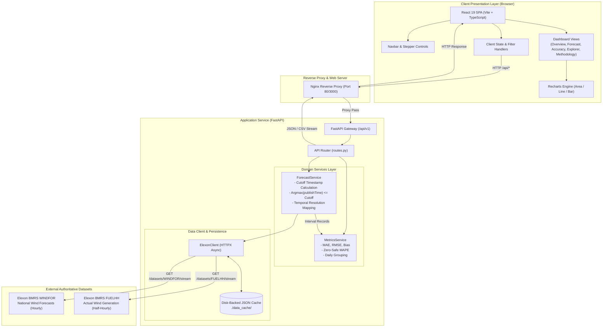
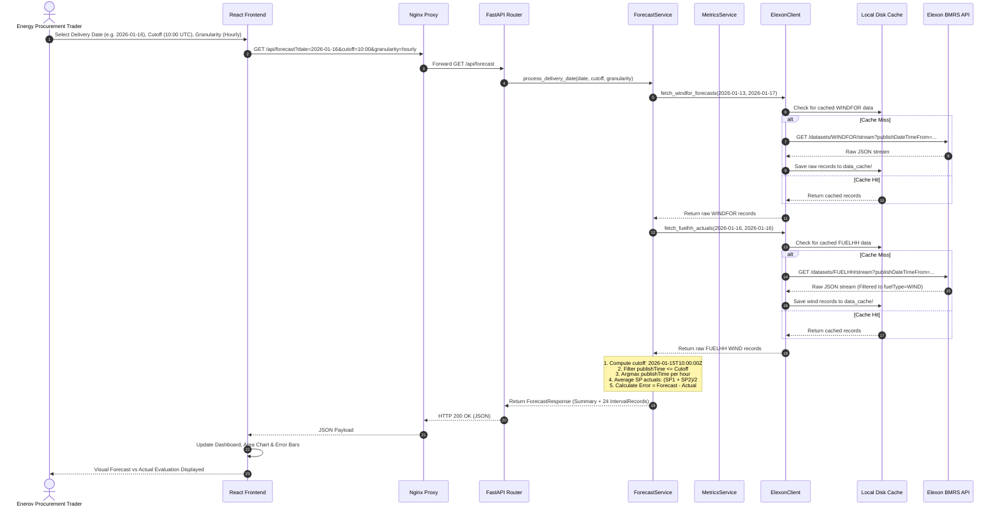

# REint AI — System Architecture & Component Design

This document details the architectural design, software components, data flow, and deployment topology of **REint AI**, an analytics and decision-support web platform for UK electricity procurement teams.

---

## 1. Architectural Principles

REint AI is architected around five core principles:

1. **Temporal Integrity (Strict Look-Ahead Prevention)**: Historical procurement evaluations must reconstruct the *exact* information set available to a trader at gate closure. The backend architecture enforces a chronological boundary on every query.
2. **Separation of Concerns**: A lightweight, high-performance Python/FastAPI service handles asynchronous ingestion, temporal matching, and statistical computation. A React/TypeScript single-page application manages visualization, interactive exploratory filtering, and state.
3. **Decoupled External Ingestion with Resilient Caching**: External Elexon BMRS streaming APIs are encapsulated behind a dedicated client with an immutable disk-backed cache layer, ensuring zero redundant external calls during repetitive analysis.
4. **Transparent Data Lineage**: Every computed metric and interval preserves its underlying record origin (Elexon publication timestamp, settlement period, and raw values) so that analysts can verify any number.
5. **Containerized Portability**: Production parity is achieved locally and in cloud staging via multi-stage Docker builds and Docker Compose orchestration.

---

## 2. End-to-End System Architecture

The following Mermaid diagram illustrates the physical and logical architecture of REint AI:



---

## 3. Component Breakdown

### 3.1 Frontend Architecture (`/frontend`)

The frontend is a single-page application built with modern web technologies:

* **React 19 & TypeScript**: Provides end-to-end type safety, component modularity, and declarative UI rendering. All API contracts are typed in `src/types/api.ts`.
* **Vite 8**: Serves as the high-speed build tool and hot-module replacement (HMR) development server.
* **Vanilla CSS Design System & Tailwind CSS**: Implements a light, modern corporate aesthetic (inspired by clean energy decision platforms) with high-contrast typography (Inter, JetBrains Mono), crisp borders, and a signature forest green palette (`#15803d` / `#1a6b3a`).
* **Recharts 3.10**: Provides responsive SVG data visualizations including:
  * Cumulative and interval-level generation profiles.
  * Over/under-forecasting error divergence bars.
  * Multi-day error trend tracking.
* **Views Structure (`src/views/`)**:
  * `OverviewView.tsx`: High-level day-ahead executive summary, KPI headline cards, generation curve overlay, and error distribution.
  * `ForecastView.tsx`: Deep-dive forecast inspection with publication timestamps, diurnal profile analysis, and interval tables.
  * `AccuracyView.tsx`: Month-wide statistical accuracy dashboard with MAE, RMSE, Bias, and daily breakdown tables.
  * `DataExplorerView.tsx`: Granular interval-by-interval table with live client-side sorting, threshold filtering (e.g. error > 1000 MW), and direct CSV download.
  * `MethodologyView.tsx`: In-app technical transparency documentation explaining gate closure formulas, settlement mapping, and metric definitions.
* **Unified Brand Identity (`src/components/Logo.tsx`)**:
  * A single, canonical vector logomark featuring the dual-hemisphere Brain (neural/biological intelligence) and Circuit (artificial/digital intelligence) in `#15803d`.
  * Reused identically across Navbar, Loading spinner, Footer, and Browser Favicon.

### 3.2 Backend Architecture (`/backend`)

The backend is structured into modular layers following clean architectural patterns:

```
backend/
├── app/
│   ├── api/
│   │   └── routes.py         # REST Endpoints, parameter validation, CSV serialization
│   ├── clients/
│   │   └── elexon_client.py  # HTTPX async client, API param formatting, disk cache
│   ├── core/
│   │   └── config.py         # Pydantic Settings, environment variables, CORS policies
│   ├── schemas/
│   │   └── models.py         # Pydantic v2 schemas: IntervalRecord, AccuracyMetrics, etc.
│   ├── services/
│   │   ├── forecast_service.py # Core domain logic: cutoff evaluation, selection, SP alignment
│   │   └── metrics_service.py  # Statistical formulas: MAE, RMSE, Bias, zero-safe MAPE
│   └── main.py               # FastAPI application factory, CORS, exception handlers
├── data_cache/               # Local JSON cache storing raw immutable Elexon responses
├── requirements.txt          # Python dependencies
└── tests/                    # Pytest test suite
```

#### Key Service Responsibilities:

1. **`ElexonClient` (`clients/elexon_client.py`)**:
   - Manages asynchronous HTTP requests to Elexon BMRS OpenAPI stream endpoints (`/datasets/WINDFOR/stream` and `/datasets/FUELHH/stream`).
   - Normalizes raw field names and filters `FUELHH` strictly to `fuelType == "WIND"`.
   - Implements disk caching using composite key hashes (`{dataset}_{start}_{end}.json`). If an immutable historical dataset exists on disk, it is served in sub-millisecond time without network latency.

2. **`ForecastService` (`services/forecast_service.py`)**:
   - Computes day-ahead decision cutoff timestamps: $T_{\text{cutoff}} = (\text{DeliveryDate} - 1 \text{ day}) \text{ at } T_{\text{cutoff\_time}} \text{ UTC}$.
   - Filters candidate forecast records: retains only records where $\text{publishTime} \le T_{\text{cutoff}}$.
   - Selects the latest forecast: $\text{argmax}_{\text{publishTime}}(\text{candidates for target startTime})$.
   - Handles resolution mapping:
     - **Hourly mode**: Averages two half-hourly actual settlement periods ($SP_{2h+1}$ and $SP_{2h+2}$) to align with the hourly forecast.
     - **Half-hourly mode**: Maps the hourly forecast across both corresponding 30-minute settlement periods.

3. **`MetricsService` (`services/metrics_service.py`)**:
   - Computes MAE, RMSE, and Bias over strictly matched intervals.
   - Enforces zero-safe MAPE calculation, omitting intervals where actual generation is 0 MW to prevent mathematical division-by-zero artifacts.
   - Groups records by calendar date for month-wide trend tracking.

---

## 4. Data Flow Sequence

The sequence diagram below shows how a user request for Day-Ahead Forecast evaluation flows through the system:



---

## 5. Deployment Topology

### 5.1 Local Containerized Topology (Docker Compose)

The multi-container deployment orchestrates two isolated services on a dedicated bridge network:

```
                           Host Machine (localhost)
                                      |
         +----------------------------+----------------------------+
         | Port 3000                                               | Port 8000
         v                                                         v
+-------------------------------+                         +-------------------------------+
| Container: reint_ai_frontend  |                         | Container: reint_ai_backend   |
| Image: nginx:alpine           |                         | Image: python:3.12-slim       |
| - Static Vite build assets    |                         | - Uvicorn ASGI Server         |
| - Nginx Reverse Proxy         | -- proxy_pass /api/ --> | - FastAPI REST Engine         |
|                               |    (reint_network)      | - Mounted volume:             |
+-------------------------------+                         |   backend_cache -> /app/cache |
                                                          +-------------------------------+
```

### 5.2 Production / Cloud Target Architecture (e.g. Render / Heroku / Vercel)

For cloud deployment:
* **Frontend**: Can be deployed to Vercel or Netlify as a static site with `VITE_API_BASE_URL` pointing to the hosted backend.
* **Backend**: Can be deployed to Render, Railway, or Heroku as a web service running `uvicorn app.main:app --host 0.0.0.0 --port $PORT`.
* **Caching**: Persistent disk volume attached at `/app/data_cache` or managed Redis instance.
